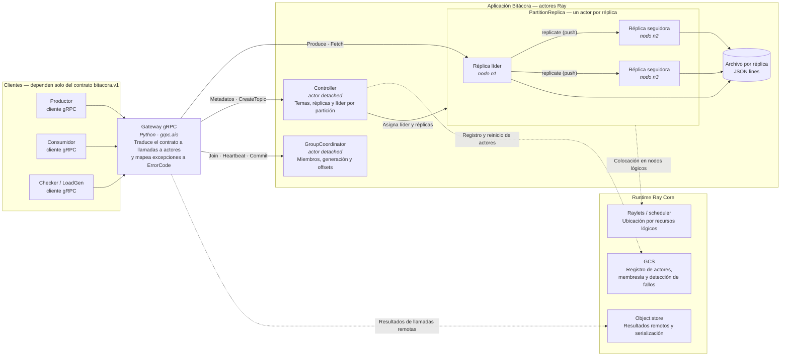
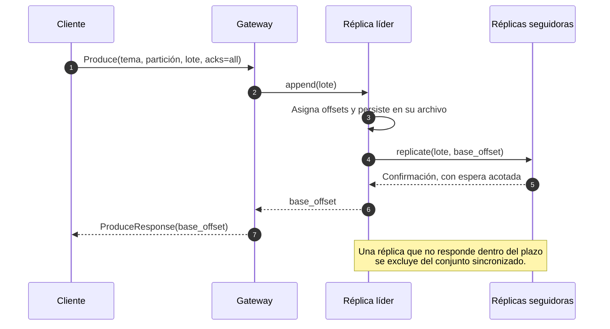
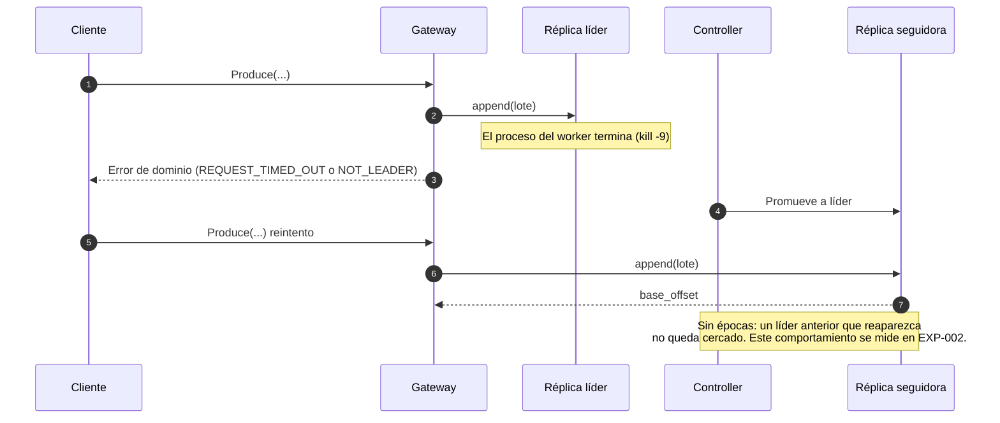

# Fase 1 — Arquitectura del prototipo y dependencias del middleware

| | |
|---|---|
| **Alcance** | Prototipo Python/Ray de Bitácora detrás del contrato gRPC `bitacora.v1` |
| **Estado** | En elaboración; se completa con los resultados de `EXP-001` a `EXP-003` |
| **Requisitos** | RF-01 – RF-09, RNF-09 ([`requirements.md`](../requirements.md)) |
| **Documentos relacionados** | [`contract.md`](../contract.md) · [`exit-gate.md`](exit-gate.md) · [`architecture.md`](../architecture.md) |

## 1. Objetivo y alcance del prototipo

El prototipo implementa el contrato público de Bitácora con el mínimo de
mecanismos propios, apoyándose en las capacidades de Ray Core. Su función es
doble: fijar el comportamiento observable que debe conservar la versión nativa
y registrar qué parte de ese comportamiento proporciona el runtime.

**Incluye:** temas con particiones y réplicas, `Produce` / `Fetch` /
`ListOffsets`, replicación del líder a las réplicas con `acks` configurable,
grupos de consumidores con generación y offsets confirmados, y el gateway
gRPC que expone el servicio.

**No incluye, de forma deliberada:** idempotencia de productor, épocas de
líder (fencing), conjunto de réplicas sincronizadas con límite de visibilidad,
autenticación y recuperación con integridad verificada. Su ausencia es parte
del objeto de estudio: los experimentos miden las consecuencias.

## 2. Vista de contenedores

El diagrama separa la aplicación (componentes de Bitácora) del runtime del que
depende. Las líneas discontinuas indican dependencia de una capacidad de Ray.

### Componentes

| Componente | Responsabilidad | Estado que posee | Capacidad de Ray de la que depende |
|---|---|---|---|
| Gateway gRPC | Implementa `Log`, `Groups` y `Admin`; localiza los actores y traduce errores del runtime (`RayActorError`, `GetTimeoutError`) a `ErrorCode` | Ninguno | Localización de actores por nombre; llamadas remotas |
| `Controller` | Crea temas y reparte réplicas entre nodos lógicos; mantiene líder y conjunto sincronizado por partición; promueve una réplica si el líder falla | Metadatos de temas y particiones | Actor con nombre y ciclo de vida independiente del cliente; reinicio de actores |
| `PartitionReplica` | Añade y lee registros con offsets contiguos; persiste en su archivo; el líder replica a las seguidoras según `acks` | Log de una réplica | Ejecución secuencial de los métodos del actor; ubicación por recursos lógicos |
| `GroupCoordinator` | Gestiona miembros, latidos, generación y asignación `range`; valida commits por generación | Pertenencia, generación y offsets del grupo | Actor con nombre; estado volcado a archivo tras cada commit |

## 3. Vista de ejecución

### 3.1 Escritura con `acks=all`

### 3.2 Pérdida del proceso que aloja al líder

## 4. Propiedad del estado

| Estado | Propietario | Persistencia | Tras la pérdida o reinicio del propietario |
|---|---|---|---|
| Log de una partición | `PartitionReplica` (una copia por réplica) | Archivo JSON lines por réplica | Pendiente de verificar en `EXP-002` |
| Líder y réplicas por partición | `Controller` | En memoria del actor | Pendiente de verificar en `EXP-002` |
| Pertenencia, generación y offsets de grupo | `GroupCoordinator` | Volcado a archivo tras cada commit | Pendiente de verificar |
| Identidad del productor | No existe en el prototipo | — | No aplica |

## 5. Mapa de dependencias del middleware

Cada fila describe un requisito distribuido, el mecanismo que lo satisface en
el prototipo y la decisión que debe tomar la versión nativa. La columna
*Verificación* referencia la prueba o experimento que confirma el supuesto; una
fila no se da por cerrada sin ella.

| Requisito | Mecanismo en el prototipo | Proporciona | Supuesto o configuración | Verificación | Decisión pendiente en la versión nativa |
|---|---|---|---|---|---|
| Orden dentro de una partición | Los métodos de un actor se ejecutan de uno en uno; el líder asigna los offsets | Ray y Bitácora | Un único llamante serializa las escrituras de la partición | Pendiente | Proceso y mecanismo que serializan las escrituras y asignan offsets |
| Invocación remota | Llamadas a métodos de actor desde el gateway | Ray | Argumentos y resultados serializables | Pendiente | Protocolo explícito con plazos e identificadores de petición |
| Estado de una réplica y su recuperación | Lista en memoria más archivo por réplica; reconstrucción desde el archivo al reiniciar | Bitácora y Ray | `max_restarts` configurado | Pendiente | Propietario del estado y formato durable con detección de corrupción |
| Ubicación de réplicas | Recursos lógicos por nodo y actores con nombre | Ray | Un recurso lógico por nodo simulado | Pendiente | Asignación determinista frente a planificación dinámica |
| Descubrimiento de componentes | Localización de actores por nombre | Ray | Actores `detached` registrados | Pendiente | Arranque desde semillas y metadatos servidos por el clúster |
| Membresía y detección de fallos | Detección de muerte de procesos por el runtime | Ray | Cada réplica en un proceso distinto | Pendiente | Latidos, sesiones y criterio de sospecha |
| Elección o promoción de líder | El `Controller` promueve una réplica tras detectar la caída | Bitácora y Ray | Sin épocas ni cercado | Pendiente | Elección entre réplicas sincronizadas con época y rechazo de líderes obsoletos |
| Reintento ante fallo | `max_task_retries` del actor | Ray | Se ejecutan 0 y 3 reintentos | Pendiente | Identidad de productor, secuencia y deduplicación en el líder |
| Replicación | El líder envía el lote a las seguidoras y espera confirmación acotada | Bitácora | Replicación por *push*; `acks=all` espera a las réplicas vivas | Pendiente | Replicación por *pull*, conjunto sincronizado y límite de visibilidad |
| Resultado de una operación remota | Respuesta síncrona con el offset base | Ray | Sin almacén de resultados propio | Pendiente | Respuesta síncrona con el offset; sin object store |
| Coordinación de grupos | Actor con generación; asignación `range`; offsets en archivo | Bitácora | Estado en un único actor | Pendiente | Coordinador y offsets replicados mediante consenso |
| Serialización entre procesos | Serialización del runtime | Ray | Registros como bytes | Pendiente | Formato de cable Protobuf y formato binario en disco |
| Control de carga | Cola de llamadas pendientes del actor | Ray | Sin límite explícito | Pendiente | Colas acotadas, plazos y presupuesto de reintentos |
| Observabilidad | Logs de la aplicación y estado del runtime | Bitácora y Ray | Identificadores de petición en logs | Pendiente | Logs estructurados con identificadores estables y métricas |

## 6. Resultados observados

Se actualiza al cerrar cada experimento. Cada hallazgo enlaza su registro en
`evidence/phase-1-ray/` y declara el estado de los invariantes del problema
([`requirements.md`](../requirements.md#invariantes-del-problema)) que el
experimento pone a prueba: `verified`, `violated` o `not_evaluable`.

| Experimento | Escenario | Invariantes evaluados | Predicción | Resultado | Implicación para el diseño nativo |
|---|---|---|---|---|---|
| `EXP-001` | Línea base sin fallos (`F0`) | I-01, I-02, I-03 | Pendiente | Pendiente | — |
| `EXP-002` | Pérdida del worker del líder, sin reintentos (`F15`) | I-02, I-03, I-04 | Pendiente | Pendiente | — |
| `EXP-003` | Pérdida del worker del líder, con reintentos (`F15`) | I-02, I-03, I-08 | Pendiente | Pendiente | — |

## 7. Limitaciones y riesgos conocidos

| ID | Descripción | Consecuencia esperada | Medida |
|---|---|---|---|
| L-01 | No hay épocas de líder | Un líder anterior puede aceptar escrituras tras una promoción | Medirlo en `EXP-002`; se resuelve en la versión nativa |
| L-02 | Los reintentos del runtime no distinguen operaciones con efecto | Posibles registros duplicados con `max_task_retries` > 0 | Medirlo en `EXP-003`; se resuelve con idempotencia de productor |
| L-03 | La replicación *push* no regula el ritmo de las seguidoras | Una réplica lenta retrasa la confirmación | Documentar el plazo configurado y su efecto |
| L-04 | Todos los nodos lógicos comparten una máquina | Los resultados cubren fallo de proceso, no de host | Declararlo en cada conclusión experimental |
| L-05 | El estado en memoria de un actor se pierde si no se ha persistido | Pérdida de metadatos o de registros no volcados | Verificar el punto de persistencia en `EXP-002` |
